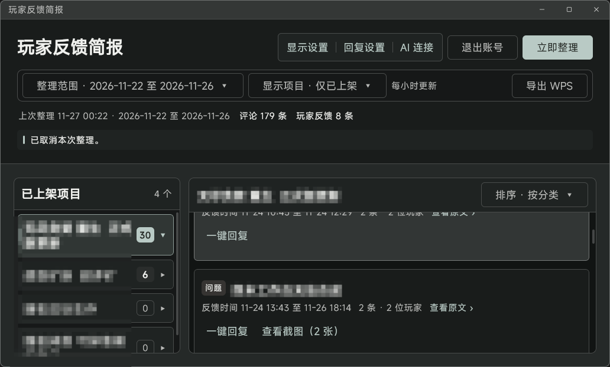
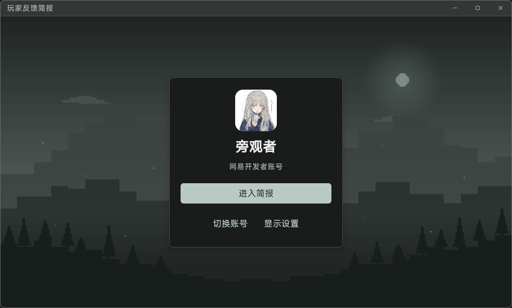

# 玩家反馈简报

给网易《MC》开发者用的 Windows 桌面工具。把作品评论和玩家反馈整理成按项目查看的简报，优先呈现可定位的问题、可执行的建议和截图线索。适用于个人非商业使用。

## 下载安装

- **Windows x64 安装版** · 下载 `.msi` 后双击，按安装向导操作。 [下载 MSI](https://github.com/Onlookz/MCFeedbackBriefing/releases/download/v1.2.11-briefing.1/MCFeedbackBriefing-1.2.11.msi)
- **Windows x64 便携版** · 解压整个 ZIP，再打开解压目录中的 `MCFeedbackBriefing.exe`。 [下载 ZIP](https://github.com/Onlookz/MCFeedbackBriefing/releases/download/v1.2.11-briefing.1/MCFeedbackBriefing-1.2.11-portable.zip)

两个版本都内置 Java 运行环境。 [查看所有版本](https://github.com/Onlookz/MCFeedbackBriefing/releases)

## 界面预览

**简报工作区**按项目展开，查看问题和建议、反馈时间、截图及回复入口。



**账号页**显示上次登录的开发者头像和名称，可一键进入简报或切换账号。



## 功能

- **AI 整理** · 合并重复反馈，整理成问题、建议和待补证据。省略纯辱骂、刷屏、广告等无关内容。遇到措辞激烈但有具体线索的反馈，使用中性的文字概括。
- **项目与时间** · 按项目展开，可切换仅已上架或全部项目。没有简报条目的项目显示 `0`。支持最近 24 小时、自选日期、按分类或时间排序，以及按反馈量排序。
- **原文和截图** · 打开原文前需要确认。反馈附带的截图有独立入口，支持翻页和缩放。
- **手动与自动回复** · 给同类反馈选用模板，勾选收件对象后发送。可分别配置问题和建议的自动回复。
- **WPS 导出** · 按项目或按条目选择范围，生成 `.xlsx` 或 `.docx`。文档会尽量嵌入反馈截图，也支持保存范围供后续自动导出。
- **显示设置** · 调整字号、项目栏位置与宽度、间距、弹窗宽度和背景色。账号页带低饱和度的像素山景动画。

## 使用说明

1. **登录开发者账号。** 启动后输入网易开发者账号邮箱和密码。也可点「使用已登录的网易会话」，填入自己在网易开发者平台当前会话的 Cookie。点「退出账号」会停止同步并返回账号页，保留头像、名称和最近的简报。会话有效时点「进入简报」即可继续，过期后重新登录。
2. **连接 AI。** 在「AI 连接」填写支持 JSON 输出的 OpenAI 兼容服务的 API 基础地址、实际模型名和服务要求的 API Key。例如基础地址可填 `https://api.openai.com/v1`，程序会追加 `/chat/completions`。本机模型可用 `http://127.0.0.1:<端口>/v1`。Windows 可勾选「记住 API Key」将密钥加密保存在本机，也可用当前用户环境变量 `MC_BRIEFING_API_KEY` 提供。
3. **整理和查看。** 在「整理范围」选最近 1 天或自定义日期，自定义日期按北京时间计算。点「立即整理」后，从项目栏展开对应项目。应用运行时每小时更新，失败时可查看上次保存的简报。点「查看原文」需要再确认，点「查看截图」可浏览该条目的附件。
4. **回复玩家。** 在简报条目点「一键回复」，选话术及发送对象后点击「发送」。在「回复设置」分别编辑问题和建议的模板。自动回复默认关闭，开启后只处理开启后收到且网易标记为可回复、尚未回复的玩家反馈。
5. **导出。** 点「导出 WPS」，选择表格或文档，再勾选要导出的项目或条目。文件写入系统「文档」下的「玩家反馈简报」文件夹。需要每次整理后自动生成时，勾选「整理后按此范围自动导出」并保存设置。

AI 整理会把经过常见敏感信息替换的反馈文本发送到所配置的服务。反馈截图在查看或文档导出时加载。Cookie、API Key 和账号数据库请留在本机。

## 从源码构建

使用 Windows 和 JDK 21。从 ASCII 路径下构建，例如 `D:\Dev\MCFeedbackBriefing`。首次构建需要下载 Gradle 和项目依赖。在该仓库根目录运行以下 PowerShell 命令。

```powershell
.\gradlew.bat :desktopApp:test :desktopApp:createDistributable
```

打开 `desktopApp/build/compose/binaries/main/app/MCFeedbackBriefing/MCFeedbackBriefing.exe` 启动。该目录包含程序、运行时及依赖，可以整个目录运行。若要生成便携 ZIP，执行 `.\gradlew.bat :desktopApp:packagePortable`，产物在 `desktopApp/build/release/portable/`。

## 来源和许可证

本项目是基于 MCDevManager v1.2.11 的第三方派生版。上游版本对应提交 `619b4417ee6764f18568968950a9a8b58d08729f`。修改者为老曾，修改日期为 2026-11-26 至 2026-11-27。派生版把 Windows 主入口改为玩家反馈简报，加入 AI 整理、原文确认、截图、回复、WPS 导出和独立界面。 [上游项目与文档](https://github.com/BitterLemonn/MCDevManager/tree/619b4417ee6764f18568968950a9a8b58d08729f)

本派生版沿用 **BitterLemon Noncommercial Copyleft License 1.0（BNCL-1.0）**，保留原版权 **Copyright © 2024–2026 BitterLemon**。协议允许在符合条款的前提下查看、修改、构建和分发源码。商业使用须事先取得版权所有者书面授权。 [完整许可证](LICENSE)

本仓库提供玩家反馈简报的完整对应源码与构建脚本，应用内可在「AI 连接」底部查看源码地址。 [GitHub 源码](https://github.com/Onlookz/MCFeedbackBriefing)

本项目与网易官方无关。遇到问题或有功能建议，可在派生仓库提交。 [GitHub Issues](https://github.com/Onlookz/MCFeedbackBriefing/issues)
